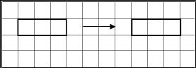

# Mathematics (Grade 1)

**ID**: 8b46d09a
**难度**: medium
**题型**: multiple_choice

## 题目
如图是把长方形向右平移了(  )格．

A．4
B．5
C．6
D．7

## 解答

**答案**: D

1. Step1:明确判断图形平移格数的方法为选定图形的一条边，看对应的这条边的位置平移了几个
2. Step2:观察图形，选定原长方形的最右边一条边
3. Step3:确定这条边向右平移了7格
4. Step4:得出长方形向右平移了7格，答案选D

## 知识点

**知识点**:
  - 平移．

---
