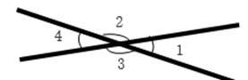

# Mathematics (Grade 1)

**ID**: b573b11f
**难度**: medium
**题型**: multiple_choice

## 题目
角1加角2等于（ ）。          

A．30º
B．150º
C．180º

## 解答

**答案**: C

1. Step1:观察图形可知角1和角2组成一个平角
2. Step2:根据平角的定义，平角的度数是180º
3. Step3:所以角1加角2等于180º，答案选C

## 知识点

**知识点**:
  - 小学数学;图形与几何;平面图形;角;线段与角的综合

---
