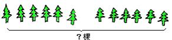

# Mathematics (Grade 1)

**ID**: b7710537
**难度**: medium
**题型**: multiple_choice

## 题目
看下图列式计算，正确的是（ ）  

$\begin{description}
\item A．6－6=0(棵)\item B．6＋6=12(棵)\item C．12－6=6(棵)
\end{description}$

## 解答

**答案**: B

1. Step1:观察图片可知，左边有6棵树，右边有6棵树
2. Step2:求树的总数需要将左右两边树的数量相加
3. Step3:所以应该用加法计算，即6 + 6 = 12(棵)，答案选B

## 知识点

**知识点**:
  - 小学数学;数与代数;应用题;常见的数学问题;图文问题

---
