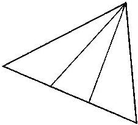

# Mathematics (Grade 1)

**ID**: cdbea767
**难度**: medium
**题型**: multiple_choice

## 题目
如图有(  )个三角形．
A．3
B．4
C．6

## 解答

**答案**: C

1. Step1:明确单个的三角形有3个
2. Step2:明确由2个三角形组成的三角形有2个
3. Step3:明确由3个三角形组成的三角形有1个
4. Step4:将上述三种情况的三角形数量相加，即3 + 2 + 1 = 6个
5. Step5:根据选项，选择C

## 知识点

**知识点**:
  - 组合图形的计数．

---
