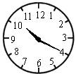

# Mathematics (Grade 1)

**ID**: ebeafc0f
**难度**: medium
**题型**: multiple_choice

## 题目
钟面上(如图)是这个时间时，(  )看到月亮．
A．有可能
B．一定能
C．一定不能

## 解答

**答案**: A

1. Step1:观察钟面，确定时间为10点20分左右
2. Step2:分析可知10点20分可能是白天，也可能是晚上
3. Step3:因为晚上有可能看到月亮，白天一定看不到月亮，所以10点20分这个时间有可能看到月亮
4. Step4:根据上述分析，答案选A

## 知识点

**知识点**:
  - 事件的确定性与不确定性．

---
