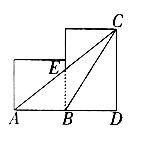

# Mathematics (Grade 1)

**ID**: fbef2182
**难度**: medium
**题型**: multiple_choice

## 题目
如下图，在三角形ABC中，边AB上的高是（  ）。

A．CB
B．CD
C．EB

## 解答

**答案**: B

1. Step1:根据三角形高的定义，从三角形的一个顶点向它的对边所在直线作垂线，顶点和垂足之间的线段叫做三角形的高。
2. Step2:在三角形ABC中，AB为底边，从顶点C向AB边所在直线作垂线，垂足为D。
3. Step3:所以边AB上的高是CD，答案选B。

## 知识点

**知识点**:
  - 

---
