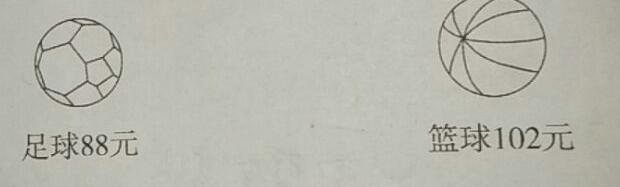

# Mathematics (Grade 1)

**ID**: 2647de1c
**难度**: medium
**题型**: short_answer

## 题目
爸爸要买一个篮球和一个足球．付给售货员200元，应找回多少钱？足球88元  篮球102元。

## 解答

**答案**: 10

1. Step1:计算一个篮球和一个足球的总价，即102 + 88 = 190元
2. Step2:用付给售货员的钱200元减去一个篮球和一个足球的总价190元，即200 - 190 = 10元，得到应找回的钱数

## 知识点

**知识点**:
  - 

---
