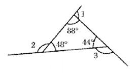

# Mathematics (Grade 1)

**ID**: 3d8c6f97
**难度**: medium
**题型**: short_answer

## 题目
小花有一个玩具如下图所示，请你算出∠1、∠2、∠3的度数，并求出这三个角的度数和。

## 解答

**答案**: 92°, 132°, 136°, 360°

1. Step1:根据平角为180°，计算∠1的度数，∠1 = 180° - 88° = 92°
2. Step2:根据平角为180°，计算∠2的度数，∠2 = 180° - 48° = 132°
3. Step3:根据平角为180°，计算∠3的度数，∠3 = 180° - 44° = 136°
4. Step4:将∠1、∠2、∠3的度数相加，92° + 132° + 136° = 360°
5. Step5:整理答案为['92°', '132°', '136°', '360°']

## 知识点

**知识点**:
  - 小学数学;图形与几何;平面图形;三角形;三角形的内角和

---
