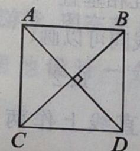

# Mathematics (Grade 1)

**ID**: b5a198a2
**难度**: medium
**题型**: short_answer

## 题目
指出下面正方形中哪两条线段互相平行，哪两条线段互相垂直．

## 解答

**答案**: AB与CD平行, AC与BD平行, AD与BC垂直

1. Step1:根据正方形的性质，明确对边互相平行，所以可得AB与CD平行
2. Step2:依据正方形对边互相平行的性质，得出AC与BD平行
3. Step3:按照正方形对角线互相垂直的性质，可知AD与BC垂直

## 知识点

**知识点**:
  - --

---
