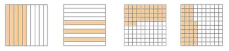

# Mathematics (Grade 2)

**ID**: 0b61233b
**难度**: hard
**题型**: fill_in_the_blank

## 题目
把下面各图涂色的部分分别用分数和小数表示出来。

分数：$\frac{\left( \begin{matrix}
   {} & {}  \\
\end{matrix} \right)}{\left( \begin{matrix}
   {} & {}  \\
\end{matrix} \right)}$    分数：$\frac{\left( \begin{matrix}
   {} & {}  \\
\end{matrix} \right)}{\left( \begin{matrix}
   {} & {}  \\
\end{matrix} \right)}$   分数：$\frac{\left( \begin{matrix}
   {} & {}  \\
\end{matrix} \right)}{\left( \begin{matrix}
   {} & {}  \\
\end{matrix} \right)}$   分数：$\frac{\left( \begin{matrix}
   {} & {}  \\
\end{matrix} \right)}{\left( \begin{matrix}
   {} & {}  \\
\end{matrix} \right)}$ 
小数：（  ）   小数：（  ）   小数：（  ）  小数：（  ）

## 解答

**答案**: 5/10, 3/10, 43/100, 36/100, 0.5, 0.3, 0.43, 0.36

1. Step1:观察第一个图，把一个正方形平均分成10份，涂色部分是5份，所以用分数表示为5/10
2. Step2:将5/10化成小数，5÷10=0.5
3. Step3:观察第二个图，把一个正方形平均分成10份，涂色部分是3份，所以用分数表示为3/10
4. Step4:将3/10化成小数，3÷10=0.3
5. Step5:观察第三个图，把一个正方形平均分成100份，涂色部分是43份，所以用分数表示为43/100
6. Step6:将43/100化成小数，43÷100=0.43
7. Step7:观察第四个图，把一个正方形平均分成100份，涂色部分是36份，所以用分数表示为36/100
8. Step8:将36/100化成小数，36÷100=0.36

## 知识点

**知识点**:
  - 

---
