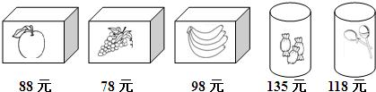

# Mathematics (Grade 2)

**ID**: 3add6faa
**难度**: hard
**题型**: fill_in_the_blank

## 题目
商店有3种水果和2种糖果．

（1）李阿姨要选购一种水果和一种糖果，一共有 $\underline{\hspace{5em}}$ 种不同的选法．
（2）李阿姨买了一箱水果和一罐糖果，付给售货员220元钱，正等着找钱呢，请你推断一下她可能买了哪两样？（至少写出两种买法） $\underline{\hspace{5em}}$ 和 $\underline{\hspace{5em}}$ ； $\underline{\hspace{5em}}$ 和 $\underline{\hspace{5em}}$ ．
（3）根据题中的信息，自己提一个数学问题并解答．

## 解答

**答案**: 6, 一箱苹果, 一罐水果糖, 一箱香蕉, 一罐棒棒糖

1. Step1:根据排列组合知识，从3种水果中选一种有3种选法，从2种糖果中选一种有2种选法，所以选购一种水果和一种糖果的选法总数为3×2=6种
2. Step2:要找出李阿姨可能的买法，需找出水果和糖果价格相加小于220元的组合，发现88元的苹果和118元的水果糖价格之和小于220元，98元的香蕉和118元的棒棒糖价格之和也小于220元
3. Step3:提出问题“买一箱苹果和一箱香蕉要花多少钱？”，通过计算88+98=186元得到答案

## 知识点

**知识点**:
  - 乘法原理;“提问题”、“填条件”应用题

---
