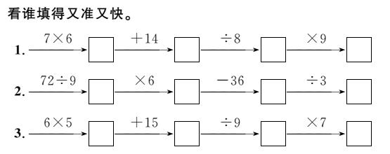

# Mathematics (Grade 2)

**ID**: 47b7e31f
**难度**: hard
**题型**: fill_in_the_blank

## 题目

看谁填得又准又快。      
1.7×6□+14□÷8□×9□
2.72÷9□×6□-36□÷3□
3.6×5□+15□÷9□×7□

## 解答

**答案**: 42, 56, 7, 63, 8, 48, 12, 4, 30, 45, 5, 35

1. Step1:计算7×6，得到42
2. Step2:计算42+14，得到56
3. Step3:计算56÷8，得到7
4. Step4:计算7×9，得到63
5. Step5:计算72÷9，得到8
6. Step6:计算8×6，得到48
7. Step7:计算48-36，得到12
8. Step8:计算12÷3，得到4
9. Step9:计算6×5，得到30
10. Step10:计算30+15，得到45
11. Step11:计算45÷9，得到5
12. Step12:计算5×7，得到35

## 知识点

**知识点**:
  - 整数的加法和减法;整数乘除法的混合运算

---
