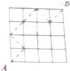

# Mathematics (Grade 2)

**ID**: a08c0081
**难度**: hard
**题型**: fill_in_the_blank

## 题目
16个大小相等的小正方形拼成一个大正方形，现从点A走到点B，每次只能沿着小正方形的对角线从一个顶点到另一个顶点，行进中同一个点或同一条线段只能经过一次，（如图中的虚线就是一种走法），共有 $\underline{\hspace{5em}}$ 中不同的走法．

## 解答

**答案**: 27

1. Step1:观察图形，确定从点A到点B可经过类似C、D、E这样的关键节点
2. Step2:发现从A到第一个关键节点共有3种不同的走法
3. Step3:发现从第一个关键节点到第二个关键节点共有3种不同的走法
4. Step4:发现从第二个关键节点到点B共有3种不同的走法
5. Step5:根据乘法原理，将各段的走法数相乘，即3×3×3=27种不同的走法

## 知识点

**知识点**:
  - 排列组合

---
