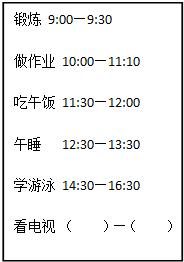

# Mathematics (Grade 2)

**ID**: b66e0f4a
**难度**: hard
**题型**: fill_in_the_blank

## 题目
奇思的一天．
（1）奇思做作业用了 $\underline{\hspace{5em}}$ 分钟．
（2）小面的时间奇思在做什么？
9：28 $\underline{\hspace{5em}}$ 
11：50 $\underline{\hspace{5em}}$ 
13：01 $\underline{\hspace{5em}}$ 
（3）奇思从19：20开始看电视，看了40分钟，几时几分结束？填一填．

## 解答

**答案**: 70, 锻炼, 吃午饭, 午睡

1. Step1:计算奇思做作业的时长，用结束时刻11时10分减去开始时刻10时，得到1时10分，再将1时10分换算为70分钟
2. Step2:判断9：28所在时间段，9：28在9：00 - 9：30之间，所以此时奇思在锻炼
3. Step3:判断11：50所在时间段，11：50在11：30 - 12：00之间，所以此时奇思在吃午饭
4. Step4:判断13：01所在时间段，13：01在12：30 - 13：30之间，所以此时奇思在午睡

## 知识点

**知识点**:
  - 日期和时间的推算

---
