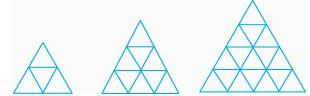

# Mathematics (Grade 2)

**ID**: db38cb61
**难度**: hard
**题型**: fill_in_the_blank

## 题目
自主探索。

1.如果下层放11个，一共需（）个三角形积木。
2.如果下层放n个，一共需（）个三角形积木。
3.如果下层放15个，一共需（）个三角形积木。
4.现有400个三角形积木，下层应该放几个？

## 解答

**答案**: 36, (n+1)*(n+1)/4, 64, 39

1. Step1:根据示例发现规律，当下层有n个三角形积木时，总个数为(n+1)×(n+1)÷4；
2. Step2:当下层放11个时，代入公式计算，即(11+1)×(11+1)÷4 = 12×3 = 36；
3. Step3:当下层放n个时，根据规律得出总个数为(n+1)×(n+1)÷4；
4. Step4:当下层放15个时，代入公式计算，即(15+1)×(15+1)÷4 = 16×4 = 64；
5. Step5:已知有400个三角形积木，先计算400×4 = 1600，因为1600 = 40×40，所以下层个数为40 - 1 = 39。

## 知识点

**知识点**:
  - 

---
