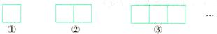

# Mathematics (Grade 2)

**ID**: e39a067d
**难度**: hard
**题型**: fill_in_the_blank

## 题目

如图，像这样摆1个正方形要______根小棒，摆2个正方形要______根小棒，摆3个正方形要______根小棒，摆10个正方形要______根小棒，摆n个正方形要______根小棒．

## 解答

**答案**: 4, 7, 10, 31, 1+3n

1. Step1:分析摆1个正方形的情况，得出需要小棒数量为1+3=4根
2. Step2:分析摆2个正方形的情况，得出需要小棒数量为1+3×2=7根
3. Step3:分析摆3个正方形的情况，得出需要小棒数量为1+3×3=10根
4. Step4:总结规律，得出摆n个正方形需要小棒数量为1+3n根
5. Step5:当n=10时，计算1+3×10=31根

## 知识点

**知识点**:
  - 数与形结合的规律．

---
