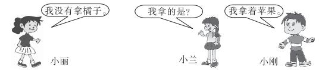

# Mathematics (Grade 2)

**ID**: ecb536fd
**难度**: hard
**题型**: fill_in_the_blank

## 题目
想一想，填一填。（她们分别拿着苹果、梨和橘子）

小丽拿着（）   
小刚拿着（）  
小兰拿着（）

## 解答

**答案**: 梨, 苹果, 橘子

1. Step1:已知小刚拿着苹果，因为三人分别拿着苹果、梨和橘子，所以小丽和小兰拿的是梨和橘子
2. Step2:又因为小丽说没有拿橘子，所以小丽拿的是梨
3. Step3:小丽拿梨，小刚拿苹果，所以小兰拿的是橘子

## 知识点

**知识点**:
  - 等价条件转换法解逻辑推理问题(奥数)

---
