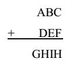

# Mathematics (Grade 2)

**ID**: 45eedbf0
**难度**: hard
**题型**: multiple_choice

## 题目
将数字1～9填入下面竖式，相同字母代表相同数字，不同字母代表不同数字。若“H”= 4，那么四位数GHIH=（）
A.1454
B.1444
C.1434
D.1424

## 解答

**答案**: D

1. Step1:因为GHIH是两个三位数的和，所以其千位数字G=1
2. Step2:由于不同字母代表不同数字且数字范围是1 - 9，H = 4，所以C、F 分别是6和8或5和9
3. Step3:假设C、F 分别是6和8，那么A、D分别是5和9，B、E分别是2和3，计算可得两数和是1464，不符合题意
4. Step4:假设C、F 分别是5和9，此时A、D分别是6和8或7和6
5. Step5:假设A、D分别是6和8，B、E分别是2和3，计算和是1464，不符合题意
6. Step6:假设A、D分别是7和6，B、E分别是8和3，计算和是1424，符合题意

## 知识点

**知识点**:
  - 万以内数的加减法

---
