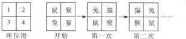

# Mathematics (Grade 2)

**ID**: d7c1364e
**难度**: hard
**题型**: multiple_choice

## 题目
如图，四个小动物排座位，一开始，小鼠坐在第1号座位，小猴坐在第2号座位，小兔坐在第3号座位，小猫坐在第4号座位．以后它们不断地交换位子，第一次上下两排交换，第二次在第一次交换后左右两列交换，第三次再上下两排交换，第四次再左右左右两列交换…这样一直换下去，第十四次交换座位后，小兔坐在第（  ）号座位上．
A．1
B．2
C．3
D．4

## 解答

**答案**: B

1. Step1:明确初始座位情况，小鼠坐第1号座位，小猴坐第2号座位，小兔坐第3号座位，小猫坐第4号座位
2. Step2:分析交换规律，第一次上下两排交换，第二次左右两列交换，如此循环
3. Step3:观察小兔座位变化，自第一次交换后依次为①→②→④→③→①…，发现每4次交换为一个循环
4. Step4:计算14次交换中包含的完整循环数及余数，14÷4=3…2
5. Step5:根据计算结果，第14次交换后小兔座位与第二次交换后的座位相同
6. Step6:得出第二次交换后小兔坐在第2号座位，所以第14次交换座位后，小兔坐在第2号座位

## 知识点

**知识点**:
  - 通过操作实验探索规律．

---
