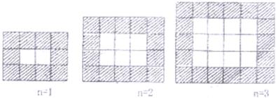

# Mathematics (Grade 2)

**ID**: e84d272a
**难度**: hard
**题型**: multiple_choice

## 题目
如图，用同样规格的黑白两色的 正方形瓷砖铺设矩形地面，请观察图形并解答下列问题．

在第7个图中，共有（  ）白块瓷砖．
A．7块
B．8块
C．42块
D．56块

## 解答

**答案**: D

1. Step1:分析第1个图，得出白块瓷砖块数为2×1=2块
2. Step2:分析第2个图，得出白块瓷砖块数为3×2=(2 + 1)×2=6块
3. Step3:分析第3个图，得出白块瓷砖块数为4×3=(3 + 1)×3=12块
4. Step4:总结规律，得出第n个图中白块瓷砖块数为n(n + 1)块
5. Step5:将n = 7代入规律式子，计算7×(7 + 1)=56块
6. Step6:得出第7个图中共有56块白块瓷砖，对应选项D

## 知识点

**知识点**:
  - 数与形结合的规律．

---
