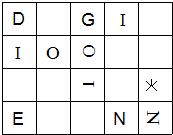

# Mathematics (Grade 2)

**ID**: ec00f10e
**难度**: hard
**题型**: multiple_choice

## 题目
10、一个棱长为1的小正方体形状的骰子，它的六个面上各写有一个大写英文字母D、E、G、I、N、O中的一个．先将它放在由20个边长为1的小正方形拼成的4×5的棋盘的左上角的小方格上，令字母D朝上(如图所示)，然后将它连续的向邻格翻动，并且恰好经过4×5棋盘上的其余的19个小方格各1次(共翻动了19次)，最终停止在棋盘的右下角的小方格上．如果图中小方格中给定的字母是骰子在翻动到该小方格上时，骰子朝上的面上所写的字母(字母可“正放”、“横放”或“倒放”)．那么，骰子翻动到画有“﹡”的小方格时，骰子朝上的面所写的字母是(  )
A．O
B．E
C．G
D．I

## 解答

**答案**: A

1. Step1:明确骰子的六个面分别写有字母D、E、G、I、N、O
2. Step2:找出字母的对应关系，即E的对面是O，N的对面是I，D的对面是G，N与O为临面
3. Step3:根据题意，骰子要连续向邻格翻动，恰好经过棋盘其余19个小方格各1次，最终停在棋盘右下角小方格
4. Step4:通过实际操作或推理，确定翻滚到18次时，N倒放在右下角的位置
5. Step5:此时再向上翻滚一次，可得到向上一面的字母为O

## 知识点

**知识点**:
  - 逻辑推理．

---
