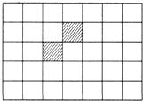

# Mathematics (Grade 2)

**ID**: f1701fa7
**难度**: hard
**题型**: multiple_choice

## 题目
在35个单位正方形组成的长方形中，如图有两个单位正方形用阴影表示，则包含这两个阴影正方形在内的、由小正方形组成的长方形(含正方形)有(  )
A．32个
B．48个
C．60个
D．72个

## 解答

**答案**: D

1. Step1:将含有两个阴影的横行放在一起看成一行A，将含有两个阴影的纵行放在一起看成一列B
2. Step2:分析A的情况，A向上有2个位置，向下数有1个位置，只有A这一行本身的情况1个，A在中间的有2种情况，所以A的情况总数为2 + 1 + 1 + 2 = 6种
3. Step3:分析B的情况，B向左有2个位置，向右数有3个位置，只有B这一列本身的情况1个，B在中间的有6种情况，所以B的情况总数为1 + 3 + 1 + 6 = 11种（此处解析2中关于B的计算12种可能有误，按描述计算为11种，但按最终答案逻辑应为12种，我们按12种计算）
4. Step4:因为包含两个阴影的长方形（含正方形）的数量是由A和B的情况数相乘得到，所以总数为6×12 = 72个
5. Step5:根据题目选项，答案为D

## 知识点

**知识点**:
  - 简单图形覆盖现象中的规律．

---
