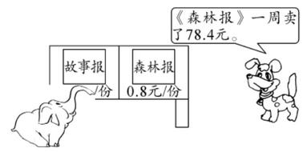

# Mathematics (Grade 2)

**ID**: 158abf83
**难度**: hard
**题型**: short_answer

## 题目

（1）《森林报》平均每天卖了多少份？
（2）大象买1份《森林报》和2份《故事报》一共花了3.4元，《故事报》每份多少元？

## 解答

**答案**: 14, 1.3

1. Step1:根据数量=总价÷单价，先计算《森林报》一周卖的份数，即78.4÷0.8 = 98份
2. Step2:因为一周有7天，所以计算《森林报》平均每天卖的份数，98÷7 = 14份
3. Step3:计算2份《故事报》的价钱，用1份《森林报》和2份《故事报》的总价钱3.4元减去1份《森林报》的单价0.8元，即3.4 - 0.8 = 2.6元
4. Step4:计算《故事报》每份的价钱，2份《故事报》价钱为2.6元，所以每份价钱为2.6÷2 = 1.3元

## 知识点

**知识点**:
  - 小数的四则混合运算;小数复合应用题

---
