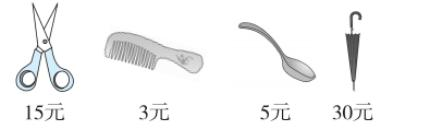

# Mathematics (Grade 2)

**ID**: 1b39ea8c
**难度**: hard
**题型**: short_answer

## 题目
（生活情景题）

（1）买8把梳子需要多少元？
（2）剪刀的价钱是勺子的几倍？
（3）40元正好可以买什么？请给出两种买法？
（4）请你再提出一个数学问题，并尝试解答。

## 解答

**答案**: 24, 3, 2个勺子和一把伞, 2把剪刀2个勺子, 5

1. Step1:已知梳子单价为3元，根据单价×数量=总价，计算8把梳子的总价，即3×8=24元，得到买8把梳子需要24元
2. Step2:已知剪刀单价15元，勺子单价5元，根据整数除法意义，计算剪刀价钱是勺子的几倍，即15÷5=3
3. Step3:考虑物品价格组合，买法一：2个勺子价格为2×5=10元，一把伞价格30元，10+30=40元，所以可以买2个勺子和一把伞；买法二：2把剪刀价格为15+15=30元，2个勺子价格为2×5=10元，10+30=40元，所以可以买2把剪刀2个勺子
4. Step4:提出问题“剪刀的价格是梳子的几倍？”，已知剪刀单价15元，梳子单价3元，计算15÷3=5

## 知识点

**知识点**:
  - 用口诀求商;乘法口诀

---
