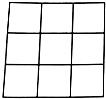

# Mathematics (Grade 2)

**ID**: f93078f5
**难度**: hard
**题型**: short_answer

## 题目
在一个3×3的方格表中，共有多少个正方形？多少个长方形？

## 解答

**答案**: 14, 22

1. Step1:设每个小正方形边长为1，计算边长为1的正方形个数，3×3 = 9个
2. Step2:计算边长为2的正方形个数，(3 - 1)×(3 - 1) = 2×2 = 4个
3. Step3:计算边长为3的正方形个数，(3 - 2)×(3 - 2) = 1×1 = 1个
4. Step4:将不同边长的正方形个数相加，9 + 4 + 1 = 14个，得到正方形总数
5. Step5:计算长为2宽为1的长方形个数，共12个
6. Step6:计算长为3宽为1的长方形个数，共6个
7. Step7:计算长为3宽为2的长方形个数，共4个
8. Step8:将不同规格的长方形个数相加，12 + 6 + 4 = 22个，得到长方形总数

## 知识点

**知识点**:
  - 组合图形的计数

---
