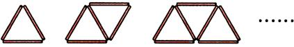

# Mathematics (Grade 2)

**ID**: 79d73cdf
**难度**: medium_easy
**题型**: fill_in_the_blank

## 题目
照下面的方法摆三角形，摆1个需要3根小棒，摆2个需要5根小棒，摆3个需要7根小棒，摆10个需要（______）根小棒。

## 解答

**答案**: 21

1. Step1:分析小棒数量规律，摆1个三角形用3根小棒，可写成1×2 + 1；摆2个三角形用5根小棒，可写成2×2 + 1；摆3个三角形用7根小棒，可写成3×2 + 1。
2. Step2:总结得出摆n个三角形需要小棒的数量公式为2n + 1。
3. Step3:题目要求摆10个三角形，将n = 10代入公式2n + 1，即2×10 + 1。
4. Step4:计算2×10 + 1 = 20 + 1 = 21。

## 知识点

**知识点**:
  - 小学数学;数与代数;应用题;常见的数学问题;数与形

---
