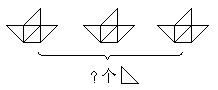

# Mathematics (Grade 2)

**ID**: 9eeb9b6c
**难度**: medium_easy
**题型**: fill_in_the_blank

## 题目
看图列式   

## 解答

**答案**: 5×3＝15（个）

1. Step1:观察图片可知，图中有3个相同的图形，每个图形由5个三角形组成
2. Step2:求三角形的总数，就是求3个5是多少
3. Step3:根据乘法的意义，用乘法计算，列式为5×3
4. Step4:计算5×3的结果为15，单位是个，所以完整算式是5×3＝15（个）

## 知识点

**知识点**:
  - 小学数学;数与代数;应用题;常见的数学问题;图文问题

---
