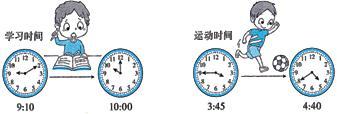

# Mathematics (Grade 2)

**ID**: b162063f
**难度**: medium_easy
**题型**: fill_in_the_blank

## 题目
周六小明给自己制定了一个学习和运动的时间计划（如下图）。他计划学习（______）分钟，运动（______）分钟。

## 解答

**答案**: 50, 55

1. Step1:计算学习时间，10时 - 9时10分 = 50分，所以学习时间是50分钟
2. Step2:计算运动时间，4时40分 - 3时45分 = 55分，所以运动时间是55分钟

## 知识点

**知识点**:
  - 小学数学;数与代数;常见的量;时间单位及换算;经过时间的计算

---
