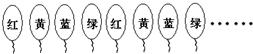

# Mathematics (Grade 2)

**ID**: 6133f936
**难度**: medium_easy
**题型**: multiple_choice

## 题目
依次排列，第30个是（  ）气球．
A．红
B．黄
C．蓝

## 解答

**答案**: B

1. Step1:明确这串气球的排列规律是4个气球为一个循环周期，顺序是红黄蓝绿
2. Step2:用30除以4，即30÷4=7…2，得出第30个气球是第8个循环周期的第2个
3. Step3:根据排列顺序，确定第8循环周期的第2个气球是黄色

## 知识点

**知识点**:
  - 事物的间隔排列规律．

---
