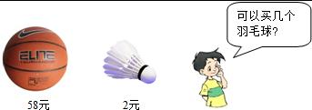

# Mathematics (Grade 2)

**ID**: 15cbc203
**难度**: medium_easy
**题型**: short_answer

## 题目
李老师带100元到商店买一个篮球，剩下的钱买羽毛球．

## 解答

**答案**: 21

1. Step1:计算买完一个篮球后剩下的钱数，100 - 58 = 42（元）
2. Step2:根据“总价÷单价=数量”，用剩下的钱数除以羽毛球单价，42÷2 = 21（个）

## 知识点

**知识点**:
  - 整数、小数复合应用题．

---
