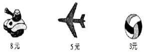

# Mathematics (Grade 2)

**ID**: c169d7ba
**难度**: medium
**题型**: fill_in_the_blank

## 题目
球球去超市买玩具，玩具价格如图2所示，那么买4个玩具坦克需要（_______）元，买2个玩具飞机需要（_______）元，买6个玩具皮球需要（_______）元，球球至少需要带（_______）元才可以买到这些玩具；他一共带了100元，买完玩具还剩（_______）元。
图2

## 解答

**答案**: 32, 10, 18, 60, 40

1. Step1:已知玩具坦克单价8元，买4个玩具坦克，根据总价=单价×数量，可得8×4 = 32元
2. Step2:已知玩具飞机单价5元，买2个玩具飞机，根据总价=单价×数量，可得5×2 = 10元
3. Step3:已知玩具皮球单价3元，买6个玩具皮球，根据总价=单价×数量，可得3×6 = 18元
4. Step4:要买到这些玩具，至少需带的钱数为买4个玩具坦克、2个玩具飞机、6个玩具皮球的总价之和，即32 + 10 + 18 = 60元
5. Step5:球球带了100元，买完玩具还剩的钱数为100 - 60 = 40元

## 知识点

**知识点**:
  - 小学数学;数与代数;应用题;常见的数学问题;图文问题

---
