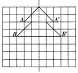

# Mathematics (Grade 2)

**ID**: e46e096b
**难度**: medium
**题型**: fill_in_the_blank

## 题目
数一数，说一说你发现了什么？
（1）图中点A与点A'到对称轴的距离都是_____小格，点B与点B′都是_____小格．
（2）我们发现了轴对称图形中对应点到对称轴的距离_____．

## 解答

**答案**: 2, 3, 相等

1. Step1:观察图形，从图中可数出点A与点A'到对称轴的距离都是2小格
2. Step2:继续观察图形，数出点B与点B′到对称轴的距离都是3小格
3. Step3:根据前面数出的距离，总结发现轴对称图形中对应点到对称轴的距离相等

## 知识点

**知识点**:
  - 小学数学;图形与几何;图形与变换;轴对称的认识及辨认

---
