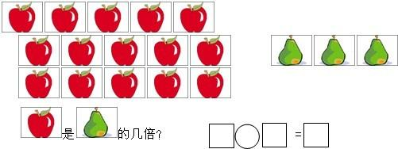

# Mathematics (Grade 2)

**ID**: fee844c4
**难度**: medium
**题型**: fill_in_the_blank

## 题目
所用的乘法口诀：$\underline{\hspace{5em}}$．

## 解答

**答案**: 三五十五

1. Step1:明确问题是求所用的乘法口诀，先需确定计算式
2. Step2:由已知苹果有15个，梨有3个，根据求一个数是另一个数的几倍用除法，得出计算式为15÷3
3. Step3:计算15÷3时，所用的乘法口诀为三五十五

## 知识点

**知识点**:
  - 表内除法．

---
