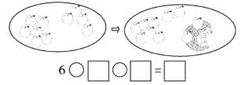

# Mathematics (Grade 2)

**ID**: 0d564e94
**难度**: medium_hard
**题型**: fill_in_the_blank

## 题目
看图列式计算。 （kàn tú liè shì jì suàn）

## 解答

**答案**: 6+4-2=8

1. Step1:观察左图，确定左边一堆苹果有6个
2. Step2:观察左图，确定右边一堆苹果有4个
3. Step3:因为要先求苹果总数，根据加法意义，总数为6 + 4
4. Step4:观察右图，确定刺猬拿走右边一堆的2个苹果
5. Step5:根据减法意义，用总数减去拿走的数量，即6 + 4 - 2
6. Step6:计算6 + 4 - 2的结果为8

## 知识点

**知识点**:
  - 整数加减法的混合运算;看图列式

---
