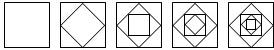

# Mathematics (Grade 2)

**ID**: 2a7dcda1
**难度**: medium_hard
**题型**: fill_in_the_blank

## 题目
观察图形的规律，把它的规律列成表．

$\begin{array}{|c|c|c|c|c|c|c|}
\hline
正方形的个数 & 1 & 2 & 3 & 4 & 5 & … \\ \hline
直角三角形的个数 & 0 & 4 & 8 & 12 & 16 & … \\ \hline
\end{array}$当正方形的个数是7时，有(    )个直角三角形，如果要得到100个直角三角形，一共画(    )个正方形．你能解释这其中的道理吗？

## 解答

**答案**: 24, 26

1. Step1:观察表格中正方形个数和直角三角形个数的关系，发现每增加一个正方形，直角三角形个数增加4个，总结出规律：当正方形个数是n时，直角三角形的个数=(n - 1)×4
2. Step2:当正方形个数n = 7时，根据上述规律计算直角三角形个数，即(7 - 1)×4 = 6×4 = 24个
3. Step3:已知直角三角形个数为100个，根据规律(n - 1)×4 = 100，先计算n - 1 = 100÷4 = 25，再得出n = 25 + 1 = 26个

## 知识点

**知识点**:
  - 数与形结合的规律．

---
