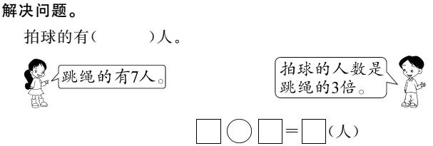

# Mathematics (Grade 2)

**ID**: 5acb18f4
**难度**: medium_hard
**题型**: fill_in_the_blank

## 题目

解决问题。
拍球的有（）人。
跳绳的有7人。
拍球的人数是跳绳的3倍。
□○□=□（人）

## 解答

**答案**: 21

1. Step1:明确已知条件，跳绳的有7人，拍球的人数是跳绳的3倍
2. Step2:分析可知要求拍球人数就是求3个7是多少
3. Step3:根据乘法的意义，求几个几是多少用乘法，列出算式3×7
4. Step4:计算3×7的结果为21，得出拍球的人数为21人

## 知识点

**知识点**:
  - 表内乘法;整数乘法应用题

---
