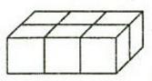

# Mathematics (Grade 2)

**ID**: 6661ade6
**难度**: medium_hard
**题型**: fill_in_the_blank

## 题目

   从前面看有（  ）个正方形，从左面看有（  ）个正方 形，从上面看有（  ）个正方形．

## 解答

**答案**: ３, ２, ６

1. Step1:从前面观察立体图形，发现有三列，每列有1个小正方形，所以从前面看有3个正方形
2. Step2:从左面观察立体图形，发现有1列，每列有2个小正方形，所以从左面看有2个正方形
3. Step3:从上面观察立体图形，发现有3列2行，3×2=6，所以从上面看有6个正方形

## 知识点

**知识点**:
  - 第二单元测试卷
--

---
