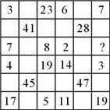

# Mathematics (Grade 2)

**ID**: 7ea73d3b
**难度**: medium_hard
**题型**: fill_in_the_blank

## 题目
按图中数字规律，问号处的数字是$\underline{\hspace{5em}}$．

## 解答

**答案**: 13

1. Step1:观察图中数字，发现可以把6×6的幻方分成3×3的小正方形这一规律
2. Step2:根据规律得知4个角的数之和为中间数
3. Step3:确定所求问号所在小正方形中，四个角的数分别为6、7、2，中间数为28
4. Step4:通过计算28 - 6 - 7 - 2得出问号处的数字为13

## 知识点

**知识点**:
  - 幻方．

---
