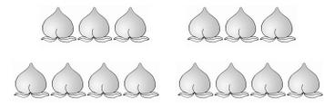

# Mathematics (Grade 2)

**ID**: 8a8a0182
**难度**: medium_hard
**题型**: fill_in_the_blank

## 题目
看图列式计算。

加法算式：□+□=□
乘法算式：□×□=□    □×□=□
除法算式：□÷□=□    □÷□=□

## 解答

**答案**: 7+7=14, 2×7=14, 7×2=14, 14÷7=2, 14÷2=7

1. Step1:观察图形可知左边有7个桃子，右边有7个桃子，根据加法意义可列出加法算式7 + 7 = 14
2. Step2:根据乘法的意义，求几个相同加数的和的简便运算，这里是2个7相加，可列出乘法算式2×7 = 14
3. Step3:交换乘法算式中两个因数的位置，可得到另一个乘法算式7×2 = 14
4. Step4:根据乘法和除法的互逆关系，由乘法算式2×7 = 14和7×2 = 14，可得到除法算式14÷7 = 2
5. Step5:根据乘法和除法的互逆关系，由乘法算式2×7 = 14和7×2 = 14，可得到除法算式14÷2 = 7

## 知识点

**知识点**:
  - 乘法口诀;乘法的认识

---
