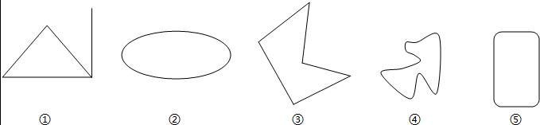

# Mathematics (Grade 2)

**ID**: bde6c807
**难度**: medium_hard
**题型**: fill_in_the_blank

## 题目
图中是封闭图形的打√，不是封闭图形的打×．

① $\underline{\hspace{5em}}$ ；② $\underline{\hspace{5em}}$ ；③ $\underline{\hspace{5em}}$ ；④ $\underline{\hspace{5em}}$ ；⑤ $\underline{\hspace{5em}}$ ．

## 解答

**答案**: ×, √, √, √, √

1. Step1:根据封闭图形和不封闭图形的意义，判断图①，它是由线段组成的不封闭图形，所以①应打×
2. Step2:判断图②，它是由曲线围成的封闭图形，所以②应打√
3. Step3:判断图③，它是由线段围成的封闭图形，所以③应打√
4. Step4:判断图④，它是由曲线围成的封闭图形，所以④应打√
5. Step5:判断图⑤，它是由线段和曲线围成的封闭图形，所以⑤应打√

## 知识点

**知识点**:
  - 平面图形的分类及识别

---
