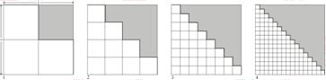

# Mathematics (Grade 2)

**ID**: c93abec8
**难度**: medium_hard
**题型**: fill_in_the_blank

## 题目
如果我们将正方形按如图所示有规律地分割下去，到第11次分割时，这个“楼梯”级数等于$\underline{\hspace{5em}}$．

## 解答

**答案**: 2048

1. Step1:观察第一次分割的图形，得出“楼梯”级数为2^1
2. Step2:观察第二次分割的图形，得出“楼梯”级数为2×2=2^2
3. Step3:观察第三次分割的图形，得出“楼梯”级数为2×2×2=2^3
4. Step4:观察第四次分割的图形，得出“楼梯”级数为2×2×2×2=2^4
5. Step5:总结规律，可知第n次分割时，“楼梯”级数为2^n
6. Step6:题目要求第11次分割时的“楼梯”级数，将n=11代入规律式子2^n
7. Step7:计算2^11=2048

## 知识点

**知识点**:
  - 数与形结合的规律．

---
