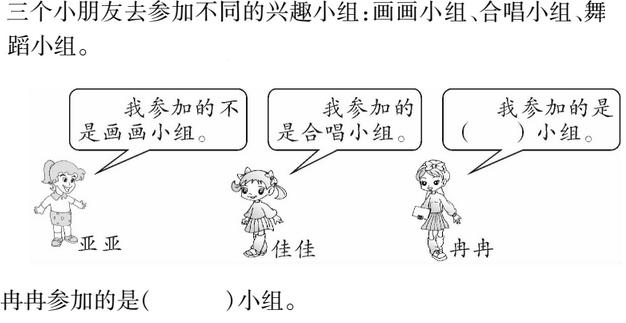

# Mathematics (Grade 2)

**ID**: f3641a40
**难度**: medium_hard
**题型**: fill_in_the_blank

## 题目

三个小朋友去参加不同的兴趣小组：画画小组、合唱小组、舞蹈小组。
亚亚 我参加的不是画画小组。
佳佳 我参加的是合唱小组。
冉冉 我参加的是（）小组。
冉冉参加的是（）小组。

## 解答

**答案**: 画画, 画画

1. Step1:已知佳佳参加的是合唱小组
2. Step2:因为亚亚参加的不是画画小组，且佳佳已确定参加合唱小组，所以亚亚参加的是舞蹈小组
3. Step3:由于三个小朋友参加不同兴趣小组，佳佳参加合唱小组，亚亚参加舞蹈小组，所以冉冉参加的是画画小组

## 知识点

**知识点**:
  - 等价条件转换法解逻辑推理问题(奥数)

---
