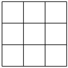

# Mathematics (Grade 2)

**ID**: f655624d
**难度**: medium_hard
**题型**: fill_in_the_blank

## 题目
数一数， 下图中有（）个正方形。

## 解答

**答案**: 14

1. Step1:数出图中1×1的小正方形的个数为9个
2. Step2:数出图中由4个小正方形（2×2）组成的正方形个数为4个
3. Step3:数出图中由9个小正方形（3×3）组成的正方形个数为1个
4. Step4:将上述三种正方形的个数相加，即9+4+1=14个

## 知识点

**知识点**:
  - 

---
