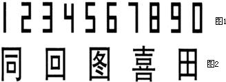

# Mathematics (Grade 2)

**ID**: f6d6514b
**难度**: medium_hard
**题型**: fill_in_the_blank

## 题目
数一数，填一填．
（1）图1的十个数字有$\underline{\hspace{5em}}$个是对称的．
（2）图2的五个汉字中有$\underline{\hspace{5em}}$个是对称的．

## 解答

**答案**: 4, 3

1. Step1:明确轴对称图形概念，即如果一个图形沿一条直线折叠，直线两旁的部分能够互相重合，这个图形叫做轴对称图形
2. Step2:观察图1的十个数字1、2、3、4、5、6、7、8、9、0，根据概念找出其中的对称数字为1、3、8、0，数出对称数字的个数为4个
3. Step3:观察图2的五个汉字同、回、图、喜、田，根据概念找出其中的对称汉字为回、喜、田，数出对称汉字的个数为3个

## 知识点

**知识点**:
  - 轴对称图形的辨识．

---
