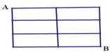

# Mathematics (Grade 2)

**ID**: 0a8d291c
**难度**: medium_hard
**题型**: multiple_choice

## 题目
如图是某城市局部街道示意图，某人想从街道口A沿街道口B，要使走的路程最短，不同的走法有（  ）种．
A．8
B．9
C．10
D．11

## 解答

**答案**: C

1. Step1:明确从街道口A到街道口B路程最短的走法规则为只向下或向右行走
2. Step2:确定这种走法下需要向下走2次，向右走3次，总共走5次
3. Step3:根据组合数的意义，从5次行走中选3次向右，剩下2次向下，计算方法数为$C_{5}^{3}$
4. Step4:计算$C_{5}^{3}$的值为10
5. Step5:得出不同走法有10种，对应选项C

## 知识点

**知识点**:
  - 排列组合．

---
