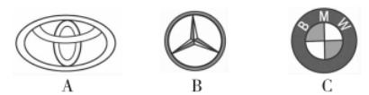

# Mathematics (Grade 2)

**ID**: 69fdce64
**难度**: medium_hard
**题型**: multiple_choice

## 题目
下面各图中，（）不是轴对称图形。

## 解答

**答案**: C

1. Step1:明确轴对称图形的定义为如果一个图形沿着一条直线对折后两部分完全重合，这样的图形叫做轴对称图形
2. Step2:观察选项A中的图形，发现其可以沿一条直线对折后两边完全重合，是轴对称图形
3. Step3:观察选项B中的图形，发现其可以沿一条直线对折后两边完全重合，是轴对称图形
4. Step4:观察选项C中的图形，发现其不能沿一条直线对折后两边完全重合，不是轴对称图形
5. Step5:得出答案为C

## 知识点

**知识点**:
  - 初步认识轴对称图形

---
