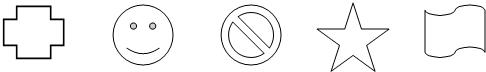

# Mathematics (Grade 2)

**ID**: 6da3eb4b
**难度**: medium_hard
**题型**: multiple_choice

## 题目
下列图形，其中是轴对称图形的有(  )

A．5个
B．4个
C．3个
D．2个

## 解答

**答案**: B

1. Step1:明确轴对称图形的概念，即如果一个图形沿着一条直线对折后两部分完全重合，这样的图形叫做轴对称图形
2. Step2:观察第一个图形，发现它沿着一条直线对折后两部分完全重合，所以它是轴对称图形
3. Step3:观察第二个图形，发现它沿着一条直线对折后两部分完全重合，所以它是轴对称图形
4. Step4:观察第三个图形，发现它沿着一条直线对折后两部分完全重合，所以它是轴对称图形
5. Step5:观察第四个图形，发现它沿着一条直线对折后两部分完全重合，所以它是轴对称图形
6. Step6:观察第五个图形，发现它无论沿哪条直线对折，两部分都不能完全重合，所以它不是轴对称图形
7. Step7:统计轴对称图形的个数为4个，得出答案为B

## 知识点

**知识点**:
  - 轴对称图形的辨识．

---
