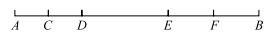

# Mathematics (Grade 2)

**ID**: 9151477c
**难度**: medium_hard
**题型**: multiple_choice

## 题目
如图，往返于A，B两地的客车途中要停靠四个站C，D，E，F，这6个车站之间需要准备不同的车票（）种。

A.15
B.30
C.21
D.42

## 解答

**答案**: C

1. Step1:明确本题可利用乘法原理求解车票种类数
2. Step2:确定车站总数为6个
3. Step3:根据公式n个车站的票的种类数=n×(n - 1)，这里n = 6，计算6×(6 - 1) = 30种
4. Step4:得出答案为C

## 知识点

**知识点**:
  - 乘法原理（排列组合）(奥数)

---
