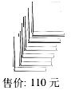

# Mathematics (Grade 2)

**ID**: 9eb2aa62
**难度**: medium_hard
**题型**: multiple_choice

## 题目
小明决定存钱去实下边这套书，如果小明从3月份开始，平均每个月存钱35元，到（）月底时，小明就能买到这套书了。

A.6 
B.4
C.5
D.7

## 解答

**答案**: A

1. Step1:计算110除以35，即110÷35，得到商为3，余数为5，这表示如果每个月存35元，存3个月后还剩5元没存够
2. Step2:因为还剩5元也需要再存1个月，所以总共需要存的月数为3 + 1 = 4个月
3. Step3:已知小明从3月份开始存钱，存4个月后，3 + 4 - 1 = 6，即到6月底时能买到这套书
4. Step4:根据上述计算结果，答案是6月底，对应选项A

## 知识点

**知识点**:
  - 多位数的有余数除法;近似数的认识（整数）

---
