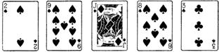

# Mathematics (Grade 2)

**ID**: a07c6a34
**难度**: medium_hard
**题型**: multiple_choice

## 题目
下列扑克牌中，是轴对称图形的有（  ）

$\begin{description}
\item A．4张\item B．3张\item C．2张\item D．0张
\end{description}$

## 解答

**答案**: D

1. Step1:明确轴对称图形的定义为如果一个图形沿着一条直线对折后两部分完全重合，这样的图形叫做轴对称图形，这条直线叫做对称轴
2. Step2:观察给出的扑克牌，对每一张牌按照轴对称图形的定义进行判断
3. Step3:得出这几张扑克牌都不是轴对称图形的结论
4. Step4:确定是轴对称图形的扑克牌有0张，所以答案选D

## 知识点

**知识点**:
  - 轴对称图形的辨识．

---
